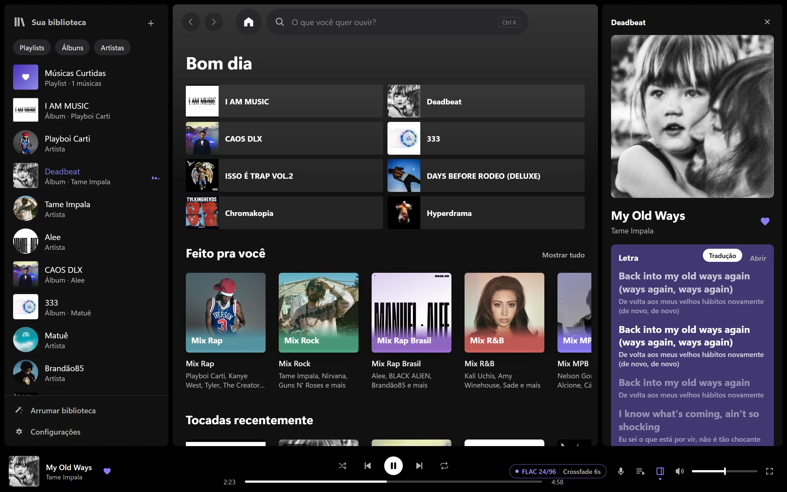

# Toxify

**English** · [Português](README.pt-BR.md)

A music player for Windows, made for people who keep their own FLAC library.

Plays FLAC and hi-res up to 192 kHz with lossless decoding, shows synced lyrics with a translation under each line, and builds mixes from what you listen to. Everything stays on your computer: no account, no login, no ads.

**[Download the installer](https://github.com/Tox1469/toxify/releases/latest/download/Toxify-Setup.exe)** · Windows 10 and 11, 64-bit



The installer puts Toxify in your user folder (`%LOCALAPPDATA%\Programs\Toxify`) without asking for an administrator password. It isn't code-signed yet, so Windows may show "Windows protected your PC": click **More info**, then **Run anyway**. To uninstall, use **Settings > Apps > Installed apps**.

### Verify the installer

Every release is built on GitHub Actions straight from this repository's source and ships with a signed build provenance attestation. With the [GitHub CLI](https://cli.github.com):

```sh
gh attestation verify Toxify-Setup.exe --repo Tox1469/toxify
```

The SHA-256 and the build log are on each [release page](https://github.com/Tox1469/toxify/releases). Or skip the installer and build it yourself (see below).

## What it does

- **Lossless playback.** The decoder is checked bit by bit against ffmpeg (the test below compares 68 million samples of a 24-bit/96 kHz FLAC). In exclusive mode the audio goes straight to the sound card, bypassing the Windows mixer, and the sample rate switches with each track.
- **Crossfade that respects the album.** Gapless tracks (live albums, concept albums) play back to back with no pause. Everywhere else the transition starts where the sound ends, not where the file ends, and skips the silence at the start of the next track.
- **Lyrics with translation.** Synced lyrics from LRCLIB, with a translation under each line in the app's language (English or Portuguese).
- **Mixes that learn your taste.** By genre, decade and artist, built from what you play to the end and what you skip. All computed on your machine.
- **Tag editor.** Title, artist, album, year, track and genre written straight to the file. Each save goes to a copy first, gets checked (the audio must stay identical) and only then replaces the original. You can undo.
- **Library cleanup.** Finds the same artist spelled two ways, site names stuck in titles, and discs of the same album showing up apart.
- **Your gear, your rules.** Pick the output (your DAC or the Windows default), turn on ReplayGain (track or album) if you want leveled volume, and open the signal path to see every step from the file to the sound card, with anything that alters the sound flagged.
- **Scrobbling.** ListenBrainz and Last.fm, with an offline queue.
- **Playlists in and out.** Import .m3u/.m3u8 from foobar2000, MusicBee or VLC; export any playlist as .m3u8.
- **Watches your folders.** New downloads show up on their own, no rescan needed.
- **Your year in music.** A recap of your top songs, artists, albums, genres and listening hours, with a card to save and share. Computed locally.
- **Windows and Discord.** Media keys, the Windows media controls, and "Listening to Toxify" on your Discord profile (can be turned off).
- **One-click updates.** When a new version is out, an Update button downloads it, checks it against the release and reopens Toxify.

## Online services

None of them needs an account, and the player works offline. Everything fetched is cached on disk.

| Service | Used for |
| --- | --- |
| [LRCLIB](https://lrclib.net) | Synced lyrics |
| Google Translate | Lyrics translation (can be turned off in Settings) |
| [Deezer](https://www.deezer.com) | Artist photos, missing covers and popular tracks |
| Discord | "Listening to Toxify" on your profile (can be turned off) |

## Under the hood

- **UI:** Tauri 2 + React + Vite (`src/`)
- **Engine:** Rust (`src-tauri/src/`). [symphonia](https://github.com/pdeljanov/Symphonia) decodes, WASAPI plays, [rubato](https://github.com/HEnquist/rubato) resamples only when needed, [lofty](https://github.com/Serial-ATA/lofty-rs) reads and writes tags, SQLite stores the library.
- **Independent speed and pitch:** [Signalsmith Stretch](https://github.com/Signalsmith-Audio/signalsmith-stretch) (MIT), in `src-tauri/vendor/signalsmith`.
- **Installer:** `src-tauri/setup/`, its own Tauri window with the compressed `Toxify.exe` inside.

## Build from source

You need Node 22+, stable Rust and WebView2 (already in Windows 11).

```sh
npm install
npm run tauri dev       # opens the app in development mode
npm run release         # builds release/Toxify-Setup.exe
```

Decoder fidelity test, with any FLAC of yours and ffmpeg on the PATH:

```sh
cd src-tauri
TOXIFY_TEST_FLAC="C:\path\song.flac" cargo test --release --lib bit_perfect -- --nocapture
```

## License

[MIT](LICENSE).
