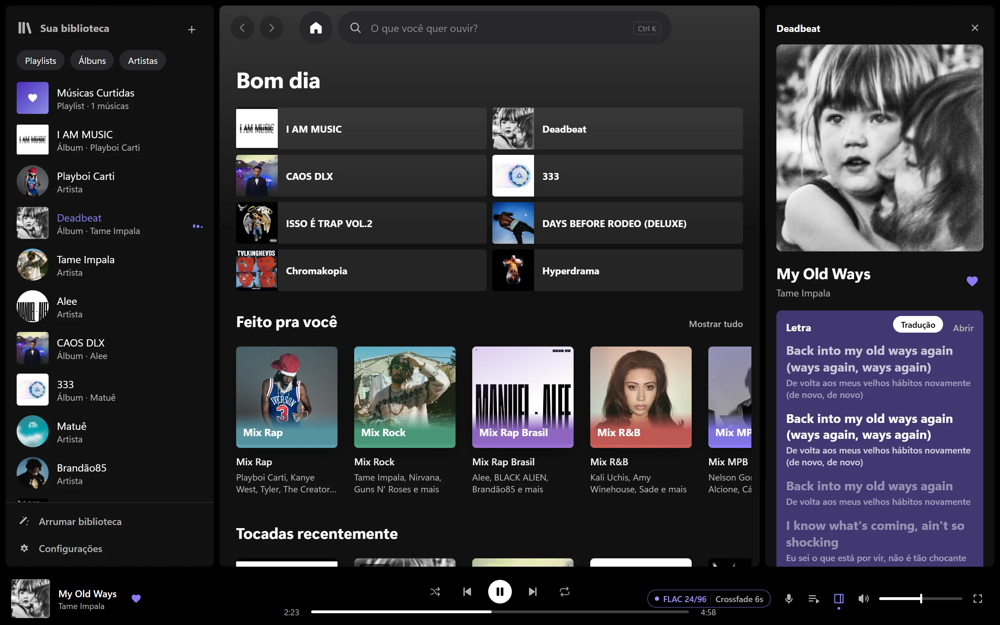

# Toxify

[English](README.md) · **Português**

Player de música para Windows, feito para quem tem a própria biblioteca em FLAC.

Toca FLAC e hi-res até 192 kHz com decodificação sem perda, mostra a letra sincronizada com a tradução embaixo de cada linha e monta mixes a partir do que você ouve. Tudo fica no seu computador: não tem conta, não tem login, não tem anúncio.

**[Baixar o instalador](https://github.com/Tox1469/toxify/releases/latest/download/Toxify-Setup.exe)** · Windows 10 e 11, 64 bits



O instalador põe o Toxify só para o seu usuário, em `%LOCALAPPDATA%\Programs\Toxify`, sem pedir senha de administrador. Ele ainda não tem assinatura digital, então o Windows pode mostrar "O Windows protegeu o computador": clique em **Mais informações** e depois em **Executar assim mesmo**. Para desinstalar, use **Configurações > Aplicativos > Aplicativos instalados**.

### Conferir o instalador

Cada versão é compilada no GitHub Actions, direto do código deste repositório, e sai com um atestado de origem assinado. Com o [GitHub CLI](https://cli.github.com):

```sh
gh attestation verify Toxify-Setup.exe --repo Tox1469/toxify
```

O SHA-256 e o log do build ficam na página de cada [versão](https://github.com/Tox1469/toxify/releases).

## O que ele faz

- **Som sem perda.** O decodificador é conferido bit a bit contra o ffmpeg (o teste abaixo compara 68 milhões de amostras de um FLAC 24 bits/96 kHz). No modo exclusivo, o som vai direto para a placa, sem passar pelo mixer do Windows, e a taxa troca a cada música.
- **Crossfade que respeita o álbum.** Faixas coladas no disco (ao vivo, álbum conceitual) tocam emendadas, sem pausa. Nas outras, a transição começa onde o som termina, não onde o arquivo termina, e pula o silêncio do começo da próxima.
- **Letra com tradução.** Letra sincronizada do LRCLIB, com a tradução embaixo de cada linha no idioma do app (português ou inglês).
- **Mixes do seu gosto.** Por gênero, década e artista, montados com o que você ouve até o fim e o que você pula. O cálculo é feito no seu computador.
- **Editor de informações.** Título, artista, álbum, ano, faixa e gênero gravados direto no arquivo. Cada gravação é feita numa cópia, conferida (o áudio precisa continuar idêntico) e só então troca o original. Dá para desfazer.
- **Biblioteca arrumada.** Encontra artista escrito de dois jeitos, nome de site no título e CDs separados do mesmo álbum.
- **Do seu jeito, no seu equipamento.** Escolha a saída (o seu DAC ou a padrão do Windows), ligue o ReplayGain (por faixa ou por álbum) se quiser volume nivelado e abra o caminho do som pra ver cada etapa do arquivo até a placa, com o que altera o som marcado.
- **Scrobbling.** ListenBrainz e Last.fm, com fila pra quando estiver sem internet.
- **Playlists de outros players.** Importa .m3u/.m3u8 do foobar2000, MusicBee ou VLC e exporta qualquer playlist em .m3u8.
- **Vigia as pastas.** O que você baixa aparece sozinho, sem precisar ler a biblioteca de novo.
- **Retrospectiva do ano.** Músicas, artistas, álbuns, gêneros e horários que você mais ouviu, com um cartão pra salvar e compartilhar. Calculada no seu computador.
- **Windows e Discord.** Teclas de mídia, controles no painel do Windows e "Ouvindo Toxify" no perfil do Discord (dá para desligar).
- **Atualização com um clique.** Quando sai versão nova, o botão Atualizar baixa, confere com a release e reabre o Toxify.

## Serviços online

Nenhum precisa de conta e o player funciona sem internet. Tudo o que vem de fora fica em cache no disco.

| Serviço | Para quê |
| --- | --- |
| [LRCLIB](https://lrclib.net) | Letras sincronizadas |
| Google Tradutor | Tradução das letras (desligável nas Configurações) |
| [Deezer](https://www.deezer.com) | Foto do artista, capa que falta no arquivo e músicas populares |
| Discord | "Ouvindo Toxify" no perfil (desligável) |

## Por dentro

- **Tela:** Tauri 2 + React + Vite (`src/`)
- **Motor:** Rust (`src-tauri/src/`). [symphonia](https://github.com/pdeljanov/Symphonia) decodifica, WASAPI toca, [rubato](https://github.com/HEnquist/rubato) converte a taxa só quando precisa, [lofty](https://github.com/Serial-ATA/lofty-rs) lê e grava tags, SQLite guarda a biblioteca.
- **Velocidade e tom independentes:** [Signalsmith Stretch](https://github.com/Signalsmith-Audio/signalsmith-stretch) (MIT), em `src-tauri/vendor/signalsmith`.
- **Instalador:** `src-tauri/setup/`, uma janela própria em Tauri com o `Toxify.exe` comprimido dentro.

## Rodar a partir do código

Precisa de Node 22+, Rust estável e o WebView2 (já vem no Windows 11).

```sh
npm install
npm run tauri dev       # abre o app em modo de desenvolvimento
npm run release         # gera release/Toxify-Setup.exe
```

Teste de fidelidade do decodificador, com qualquer FLAC seu e o ffmpeg no PATH:

```sh
cd src-tauri
TOXIFY_TEST_FLAC="C:\caminho\musica.flac" cargo test --release --lib bit_perfect -- --nocapture
```

## Licença

[MIT](LICENSE).
